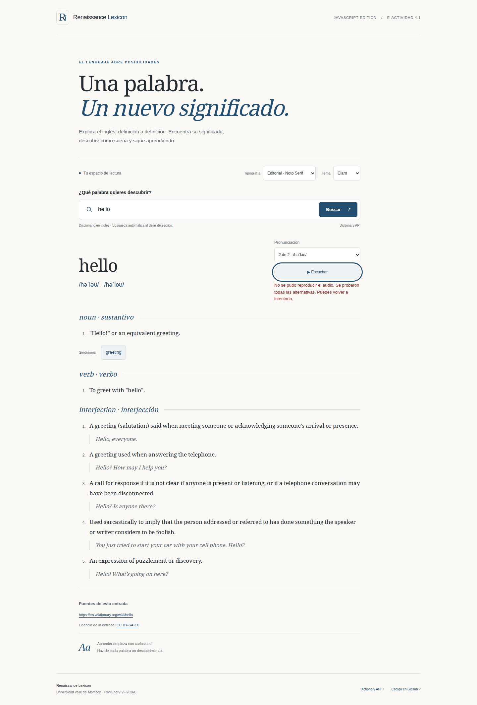
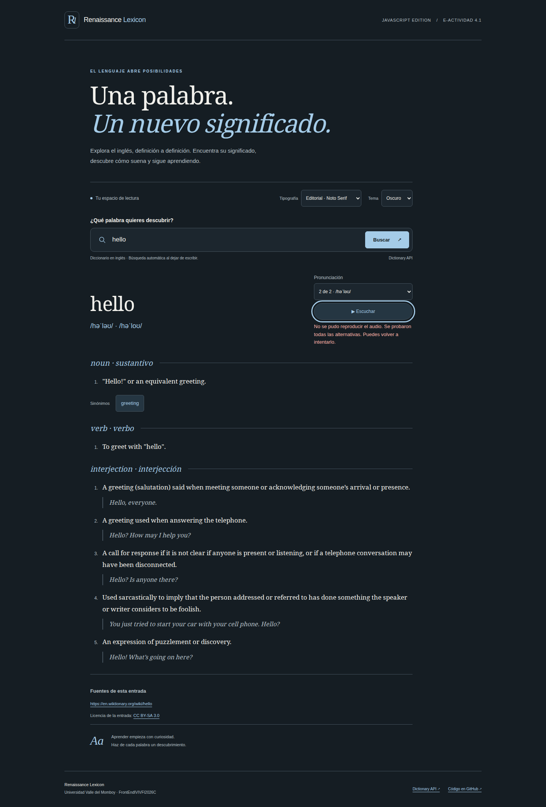
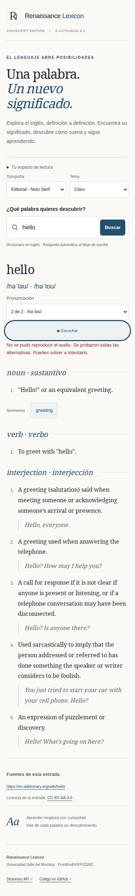
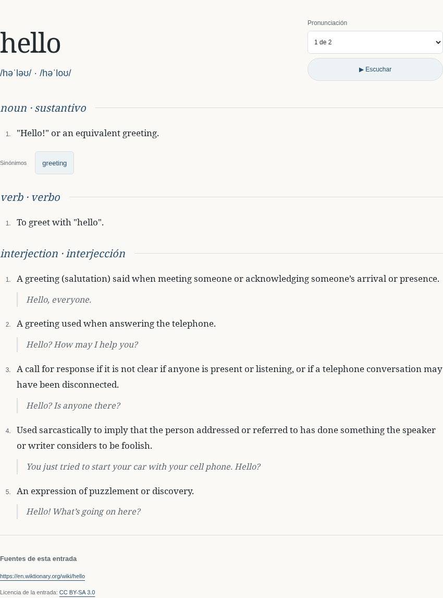
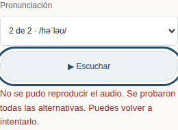
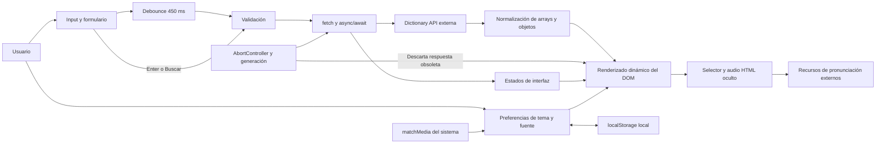
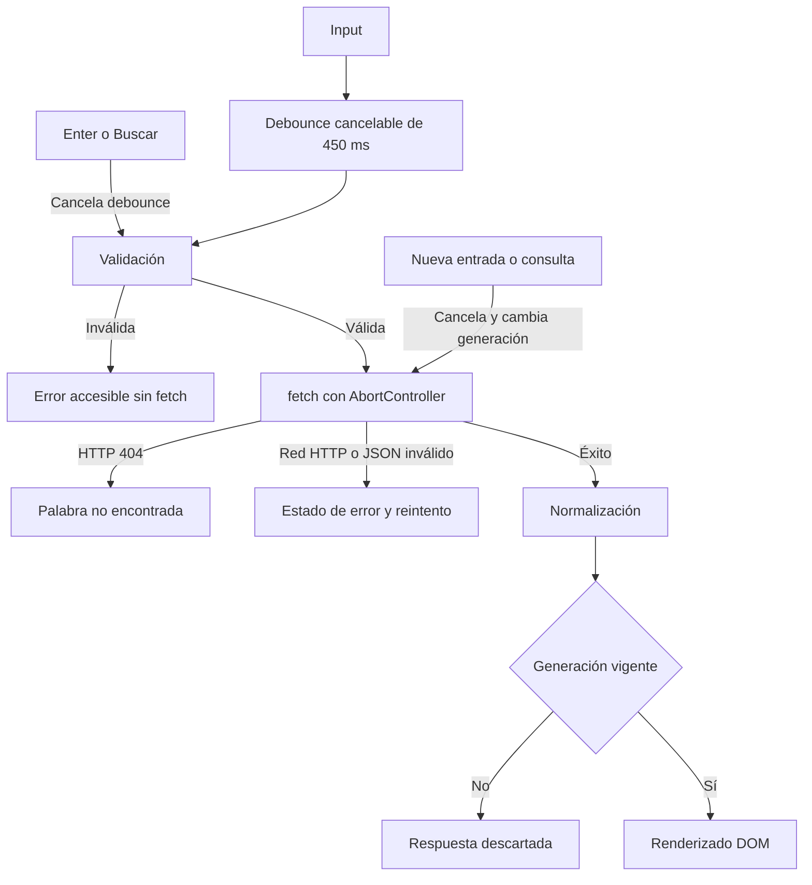
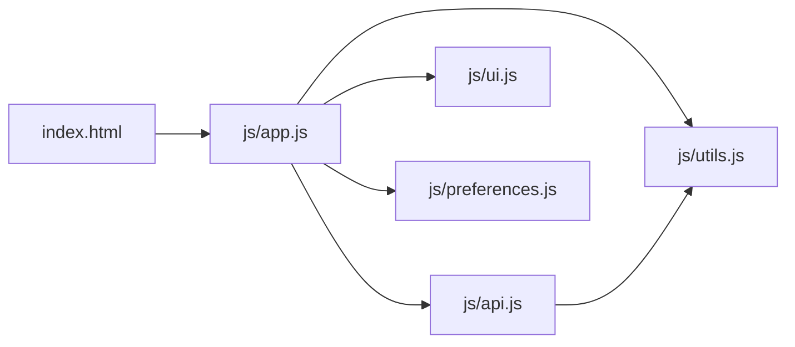
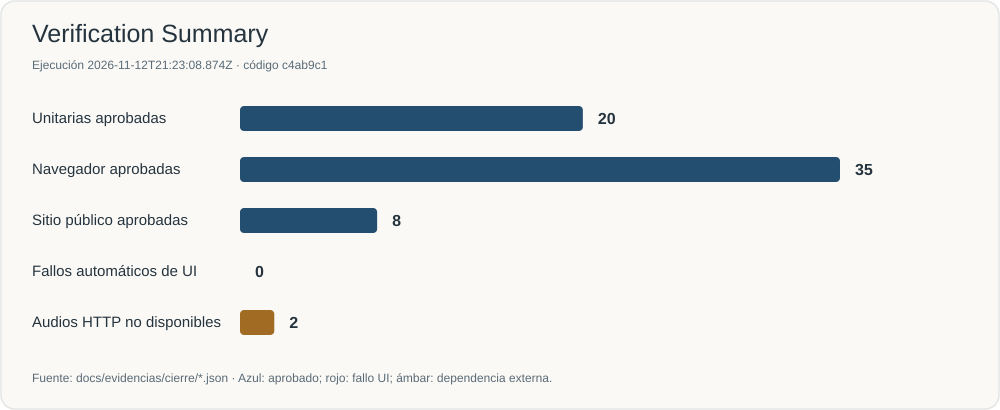
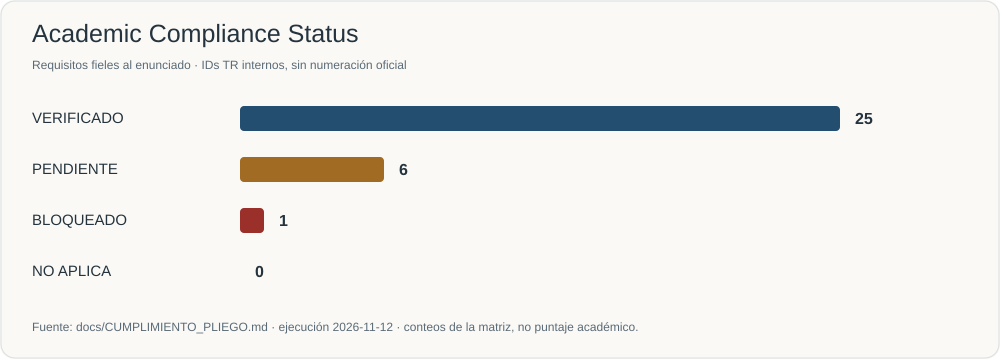

<p align="center">
  
</p>

<p align="center">
  
  
  
  
  
</p>

# Renaissance Lexicon

Un diccionario de inglés para explorar significados, partes de la oración, ejemplos, sinónimos y fonética. Construido con HTML5, CSS personalizado y JavaScript vanilla; consulta Dictionary API y permite elegir tema y tipografía de lectura.

## Live Demo

### [Abrir Renaissance Lexicon ↗](https://mmorfe-engineer.github.io/renaissance-js-uvm-e4-1/)

**[Repositorio](https://github.com/mmorfe-engineer/renaissance-js-uvm-e4-1) · [Cumplimiento del pliego](docs/CUMPLIMIENTO_PLIEGO.md) · [Pruebas y evidencia](docs/VALIDACION.md) · [PR #1 integrado](https://github.com/mmorfe-engineer/renaissance-js-uvm-e4-1/pull/1)**

Sitio comprobado con Chromium sobre GitHub Pages: HTTP 200, búsqueda real `hello` y preferencias persistentes. **TR-22: BLOQUEADO — dependencia externa.** La lógica de audio está implementada y validada mediante pruebas controladas; no se acreditó reproducción pública de los recursos de Dictionary API. Para `hello`, ambas URLs medidas devolvieron HTTP 404. El usuario confirmó ausencia de reproducción audible en `cat`, `house`, `street` y `hello`; no se midieron códigos HTTP para las tres primeras. [Informe público](docs/evidencias/cierre/public-report.json) · [Evidencia manual](docs/evidencias/cierre/manual-audio-report.json). No se añadió otra API, audio propio ni SpeechSynthesis para fabricar un PASS.

## La aplicación en funcionamiento



> **Figura 1.** Desktop claro en GitHub Pages: palabra, fonética, siete definiciones, categorías, sinónimo y fuentes reales de Dictionary API. También se muestra el fallo externo de pronunciación; no es una captura de audio exitoso.

<details>
<summary>Desktop oscuro, móvil, detalle de búsqueda y pronunciaciones</summary>



> **Figura 2.** La misma búsqueda real en tema oscuro, con el contenido y los controles del diccionario.



> **Figura 3.** Vista móvil real a 375 px. El control de pronunciación ocupa una fila propia; la consulta y las preferencias siguen disponibles.



> **Figura 4.** Resultado obtenido sin interceptar la API ni usar fixtures. Las definiciones y categorías pertenecen a la respuesta de `hello`.



> **Figura 5.** Contribución integrada de `morfemartin`: selector de alternativas, botón personalizado, foco visible y mensaje real después de fallar ambas pronunciaciones.

</details>

Capturas del 2026-11-12, obtenidas con `scripts/public-check.mjs` sobre la URL pública. [Metadatos y escenarios](docs/evidencias/cierre/public-report.json). Las pruebas con respuestas controladas se conservan separadas.

## Información académica

| Campo | Dato confirmado |
|---|---|
| Universidad | **Universidad Valle del Momboy** |
| Curso / asignatura | **FrontEndIVIVFI2026C · Taller Front End** |
| Actividad | **E-Actividad 4.1 — Aplicar conocimientos en ejercicio práctico de JS** |
| Opción | **#2 · Diccionario Web con Dictionary API** |
| Ponderación | **15 %** |
| Fecha límite | **14 de noviembre de 2026, 23:59**, hora de Venezuela |
| Estudiante 1 | **Martin Morfe.°.** |
| C.I. estudiante 1 | **8.263.711** |
| GitHub estudiante 1 | [mmorfe-engineer](https://github.com/mmorfe-engineer) |
| Estudiante 2 | **Martin Alejandro Morfe Carballo** |
| C.I. estudiante 2 | **30.539.018** |
| GitHub estudiante 2 | [morfemartin](https://github.com/morfemartin) |
| Profesor | **Anggelo Huz** |

El video es un **entregable académico separado, excluido de esta fase de cierre técnico**. Existe un [guion de 8:45](docs/GUIA_VIDEO.md); la grabación y su URL permanecen pendientes. El cierre técnico de repositorio/Pages conserva explícitos el bloqueo externo del audio y los límites de revisión manual; no equivale a completar la entrega académica.

## Propósito y alcance

La actividad demuestra JavaScript aplicado a una interfaz funcional: eventos, validación, asincronía, procesamiento de datos y DOM. La interfaz está en español y el contenido del diccionario permanece en inglés. No es un traductor ni un diccionario de español.

Las sugerencias iniciales solo disparan consultas; no contienen resultados precargados. Se admiten letras inglesas, espacios interiores, apóstrofos y guiones entre palabras, hasta 80 caracteres. Las mayúsculas y espacios exteriores se normalizan.

## Funcionalidades

- Búsqueda al terminar de escribir, al pulsar Enter o mediante Buscar.
- Definiciones, categorías, ejemplos, sinónimos interactivos, fonética, fuentes y licencia cuando la API los proporciona.
- Todas las pronunciaciones HTTPS válidas y únicas; selección, fallback acotado y reintento mediante botón personalizado.
- Estados inicial, carga, resultado, palabra ausente, red, HTTP y respuesta ilegible.
- Temas claro, oscuro y sistema; cinco familias locales con sus licencias.
- Preferencias persistentes con funcionamiento tolerante al bloqueo de almacenamiento.
- Cancelación de consultas y audio obsoletos; representación segura con `textContent`.

## Arquitectura



### Leyenda

Los nodos describen responsabilidades reales. Las flechas indican eventos, datos o control; la conexión bidireccional con `localStorage` representa lectura y persistencia local. Dictionary API y sus recursos de audio son servicios externos. AbortController cancela solicitudes y el contador de generación evita renderizar respuestas antiguas; no se utiliza backend.

## Flujo de búsqueda



### Leyenda

Los rombos representan decisiones. Las ramas distinguen entrada inválida, ausencia de palabra, error del proveedor y resultado vigente. La cancelación y la generación trabajan juntas: una respuesta atrasada no sustituye la búsqueda más reciente.

## Mapa de módulos



### Leyenda de módulos

Las flechas entre archivos JavaScript representan imports reales. `index.html` carga `app.js` como módulo ES.

| Archivo | Responsabilidad |
|---|---|
| [app.js](js/app.js) | Eventos, composición de entrada, debounce, validación, estados, timeout y concurrencia |
| [api.js](js/api.js) | fetch, clasificación de errores, normalización, pronunciaciones y URLs |
| [ui.js](js/ui.js) | DOM, sinónimos, mensajes accesibles, selección, fallback y cancelación de audio |
| [preferences.js](js/preferences.js) | Tema, cinco fuentes, persistencia y cambios del sistema |
| [utils.js](js/utils.js) | Debounce cancelable, validación y URLs HTTPS seguras |

## JavaScript en el proyecto

| Concepto evaluable | Código real y aplicación |
|---|---|
| Variables y constantes | [app.js](js/app.js): referencias DOM, controlador, generación y última palabra |
| Funciones y módulos ES | [Imports y orquestación](js/app.js), [exports reutilizables](js/utils.js) |
| Eventos | [input, composición y submit](js/app.js); [change de preferencias](js/preferences.js) |
| DOM y renderizado dinámico | [createElement, textContent, replaceChildren y listas](js/ui.js) |
| fetch y async/await | [lookupWord](js/api.js), procesamiento y errores HTTP |
| Arrays y objetos | [map, filter, flatMap, Set y normalización](js/api.js) |
| Debounce y validación | [Temporizador cancelable y reglas de entrada](js/utils.js) |
| AbortController | [Cancelación, timeout y generación](js/app.js) |
| Audio | [play, promesas, alternativas, eventos y cancelación](js/ui.js) |
| localStorage y matchMedia | [Persistencia y tema del sistema](js/preferences.js) |

Fragmentos del código evaluable:

```js
const delayedSearch = debounce(raw => search(raw), 450);
const entries = await lookupWord(word, signal);
```

La respuesta se procesa en objetos propios antes de crear elementos DOM. Nunca se interpreta el texto remoto como HTML.

## Verification / Testing



**20 unitarias**, **35 comprobaciones de navegador** y **8 comprobaciones del sitio público** aprobadas en las ejecuciones registradas; las categorías son distintas y no constituyen coverage ni un puntaje global. La disponibilidad y reproducción del audio externo siguen bloqueadas.

| Verificación | Evidencia y alcance |
|---|---|
| Lógica y preferencias | [unit-report.json](docs/evidencias/cierre/unit-report.json) y [TAP](docs/evidencias/cierre/unit.tap) |
| Interfaz determinista | [browser-report.json](docs/evidencias/cierre/browser-report.json); usa respuestas controladas |
| Pages, API y preferencias reales | [public-report.json](docs/evidencias/cierre/public-report.json); sin interceptar API |
| Audio real | [live-report.json](docs/evidencias/cierre/live-report.json); cada recurso, HTTP y reproducción |
| Colaboración | [PR #1](https://github.com/mmorfe-engineer/renaissance-js-uvm-e4-1/pull/1) y [revisión original](docs/REVISION_MORFEMARTIN.md) |

El informe unitario registra hashes de los archivos evaluados. La revisión de Codespaces del colaborador conserva su HTTP 403 y el timeout original; no se transforma en PASS porque otro entorno consulte la API posteriormente. [Metodología y límites](docs/VALIDACION.md).

## Cumplimiento del pliego



**25 verificados · 6 pendientes · 1 bloqueado · 0 no aplica**, derivados de la matriz. No representan nota ni porcentaje de aprobación académica.

La fuente única es [CUMPLIMIENTO_PLIEGO.md](docs/CUMPLIMIENTO_PLIEGO.md). Los identificadores TR son internos del proyecto, **no numeración oficial del profesor**. Los pendientes corresponden al video y a la validación accesible manual; el bloqueo corresponde a audio externo.

## Responsive y accesibilidad

Se comprobaron **320, 375, 768, 1024 y 1440 px**: ausencia de overflow, controles dentro del viewport y alturas mínimas de 44 px. El selector de pronunciación se revisa automáticamente en combinaciones de dos temas y cinco tipografías. Las capturas públicas móvil y desktop también se inspeccionaron visualmente.

Axe no detectó infracciones en los escenarios auditados. Se comprobaron automáticamente enlace de salto, teclado, foco de audio, etiquetas y anuncios. **Quedan pendientes revisión humana completa de teclado, zoom real 200 % y lector de pantalla**. La prueba auditiva manual ya fue realizada por el usuario en cuatro palabras, sin audio audible; la reproducción satisfactoria continúa sin acreditarse. No se declara certificación WCAG.

## Estructura del repositorio

```text
renaissance-js-uvm-e4-1/
├── index.html                 # Entrada semántica, formulario y preferencias
├── css/styles.css             # Diseño, temas, fuentes, foco y responsive
├── js/                        # Cinco módulos ES de la aplicación
├── assets/                    # Favicon, cinco fuentes y licencias
├── tests/                     # Lógica, preferencias y fixtures exclusivos de tests
├── scripts/                   # Servidor, validadores, gráficos, empaquetado y plantillas
├── docs/
│   ├── CUMPLIMIENTO_PLIEGO.md  # Trazabilidad canónica de requisitos
│   ├── assets/                # Hero, gráficos y capturas públicas
│   └── evidencias/            # Informes históricos, del colaborador y de cierre
├── README.md                  # Portada, demo y mapa técnico
├── REFERENCIAS.md             # Fuentes y licencias
└── package.json               # Comandos y dependencias de desarrollo
```

`dist/` y `artifacts/` son salidas locales excluidas de Git. El ZIP académico se genera al final; sus hashes y relación con el HEAD publicado se registran en `dist/FINAL_DELIVERY.json`. El reporte legible se guarda en `dist/FINAL_DELIVERY_REPORT.md`.

## Engineering Decisions

| Decisión | Motivo |
|---|---|
| JavaScript vanilla, sin framework | Hace visible el JavaScript evaluable y evita dependencias de ejecución |
| Cinco módulos ES | Separa red, datos, DOM, preferencias y utilidades sin ocultar responsabilidades |
| Debounce cancelable | Evita una consulta por carácter y duplicados al enviar el formulario |
| AbortController y generación | Cancela solicitudes y descarta resultados obsoletos |
| textContent y URLs HTTPS | Evita interpretar HTML del proveedor y protocolos inseguros |
| Preferencias tolerantes a fallos | Mantiene lectura y cambios durante la sesión aunque storage esté bloqueado |
| Semántica y estados accesibles | Etiquetas, foco y anuncios forman parte del comportamiento |
| Audio con alternativas reales | No inventa proveedores ni URLs; admite selección, fallback acotado y fallo total honesto |

## Development & Collaboration

`main` reúne la implementación del propietario y la integración. `feature/ui-accessibility-morfemartin` contiene el bloque real de pronunciaciones alternativas, control accesible, CSS y pruebas del segundo integrante.

El [PR #1](https://github.com/mmorfe-engineer/renaissance-js-uvm-e4-1/pull/1) se integró mediante **merge normal**, sin squash. Se preservaron ambos commits y GitHub confirmó a `morfemartin` como autor y committer:

- [`258af14`](https://github.com/mmorfe-engineer/renaissance-js-uvm-e4-1/commit/258af14457e74b76fd4145665550d890a2e8ab91): alternativas, fallback, interfaz accesible y pruebas.
- [`530ed50`](https://github.com/mmorfe-engineer/renaissance-js-uvm-e4-1/commit/530ed50bcd11d3e79ebe8a045c3fe52705027351): verificación de recursos y revisión documentada.

[Auditoría de colaboración](docs/COLABORACION.md) · [Evidencia del PR integrado](docs/evidencias/cierre/pr-1.json) · [Historial](https://github.com/mmorfe-engineer/renaissance-js-uvm-e4-1/commits/main/).

## Contributors

| Integrante humano | Responsabilidad |
|---|---|
| **Martin Morfe.°.** · [mmorfe-engineer](https://github.com/mmorfe-engineer) | Núcleo JS, API, integración, documentación técnica, pruebas, publicación y cierre |
| **Martin Alejandro Morfe Carballo** · [morfemartin](https://github.com/morfemartin) | Pronunciaciones alternativas, fallback/reintento, accesibilidad del control, CSS responsive y verificación de su bloque |

## Documentación

[Pliego](docs/CUMPLIMIENTO_PLIEGO.md) · [Arquitectura](docs/ARQUITECTURA.md) · [Validación](docs/VALIDACION.md) · [Colaboración](docs/COLABORACION.md) · [Revisión del colaborador](docs/REVISION_MORFEMARTIN.md) · [Guion del video](docs/GUIA_VIDEO.md) · [Entrega](docs/ENTREGA.md) · [Contrato vigente](docs/CONTRATO_MAESTRO.md) · [Referencias](REFERENCIAS.md).

## Ejecución local

Requiere Node.js 22 o posterior para scripts. La aplicación no necesita compilación ni dependencias de ejecución.

```sh
npm ci --ignore-scripts
npm start
```

Abrir `http://127.0.0.1:4173`. Usar servidor HTTP: los módulos ES no deben abrirse mediante `file://`. Se requiere Internet para la API y el audio; las fuentes son locales.

```sh
npm test
npx playwright install --with-deps chromium
npm run test:browser
LIVE_URL=https://mmorfe-engineer.github.io/renaissance-js-uvm-e4-1/ node scripts/live-check.mjs
node scripts/public-check.mjs
npm run package
```

`live-check` y `public-check` conservan un código de salida no exitoso si el audio real no se verifica; esto no invalida las comprobaciones de interfaz que sí pasaron. Los informes distinguen cada capa.

Con `main` limpio y el deployment final completado, `python3 scripts/check_links.py` y `python3 scripts/verify-delivery.py` auditan los enlaces, el ZIP generado y la correspondencia de recursos públicos; el segundo comando requiere los informes públicos recién ejecutados.

Pages publica nativamente desde `main`, carpeta `/`, con `.nojekyll`. Las plantillas opcionales están en `scripts/workflows/`; no hay CI de calidad personalizada activa. El deployment nativo de Pages es independiente de los tests locales.

## Enlaces pertinentes

[Live Demo](https://mmorfe-engineer.github.io/renaissance-js-uvm-e4-1/) · [Repositorio](https://github.com/mmorfe-engineer/renaissance-js-uvm-e4-1) · [Dictionary API](https://dictionaryapi.dev/) · [API de ejemplo hello](https://api.dictionaryapi.dev/api/v2/entries/en/hello) · [Entrega y pendientes](docs/ENTREGA.md).
